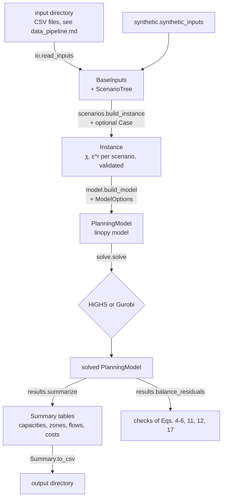

# Software architecture

## Data flow

## Modules (`src/txh2_framework/`)

| Module | Content |
|---|---|
| `parameters.py` | `Parameters`: the techno-economic parameters, with validation, the annuity factor of Eq. (2), overrides, capex scaling, and the flat record layout of `parameters.csv` |
| `inputs.py` | `BaseInputs` (scenario-independent profiles of a region), `Instance` (one model instance with scenario arrays), `Pipeline`; shape, sign and consistency checks |
| `scenarios.py` | `Level`, `ScenarioTree` (two independent factors), `Case` (sensitivity overrides), `build_instance` |
| `io.py` | read and write the input directory format |
| `model.py` | `ModelOptions`, `build_model`: variables, objective and constraints of [formulation.md](formulation.md), named by equation number |
| `solve.py` | `solve`: in-memory hand-over to HiGHS (default) or Gurobi; raises `SolveError` unless the solution is optimal |
| `results.py` | `solution_arrays`, `balance_residuals` (recomputes the balance equations from the solution), `summarize` and `Summary` |
| `synthetic.py` | the synthetic example region, illustrative parameters, the article's scenario tree |
| `cli.py` | the `txh2-framework` command: `synthetic` and `run` |

Arrays are ordered zone, hour, scenario (`[i, t, s]`). The linopy model uses the dimensions `i`, `j` (destination zone), `k`, `t` and `s`. Pipeline flows exist only on the corridors listed in the inputs (a mask on `h_tr`).

## Solvers

- **HiGHS** (default, open source, installed with `highspy`):
  - interior point followed by crossover, so the solution is a vertex;
  - suitable for the examples and for reduced instances (fewer zones, hours or scenarios).
- **Gurobi** (optional):
  - `pip install gurobipy` plus a licence, then `solve(pm, solver="gurobi")`;
  - the defaults are barrier and crossover, which is the usual choice for large planning LPs.
- Any option accepted by the solver can be passed as keyword arguments, for example `solve(pm, solver="highs", time_limit=3600)`.

## Problem size

For $\lvert I\rvert$ zones, $\lvert T\rvert$ hours, $\lvert S\rvert$ scenarios and $\lvert A\rvert$ directed pipeline arcs, the model has about

- $\lvert I\rvert\,\lvert T\rvert\,\lvert S\rvert \times 11$ hourly variables, plus storage levels $2\,\lvert I\rvert(\lvert T\rvert+1)\lvert S\rvert$ and flows $\lvert A\rvert\,\lvert T\rvert\,\lvert S\rvert$;
- about the same number of constraints.

| Instance | Variables (approx.) |
|---|---|
| synthetic example: 4 zones, 72 h, 9 scenarios | 34 thousand (26 thousand constraints) |
| 8 zones, 8,760 h, 9 scenarios, 16 arcs | about 8 million (about 6 million constraints) |

linopy builds the model from arrays. On a laptop, the full-year, eight-zone instance above builds in about a second and uses under 2 GB of memory.

Solving it is another matter. It needs a commercial barrier solver, or a reduction of the horizon, for example to representative periods with `Instance.hour_weight` set to keep the costs annual.

## Tests

`pytest` (directory `tests/`) checks:

- the data interface: validation errors and the input format round trip;
- the scenario construction and the sensitivity overrides;
- an optimal solve of the synthetic case;
- every balance equation, recomputed from the solution;
- the bounds of Eqs. (7), (8), (13), (14) and (17);
- that pipeline flows appear only on corridors;
- that the cost components sum to the objective;
- the load-flexibility variant, the two extensions, a case without pipelines, the command line and the minimal example.
