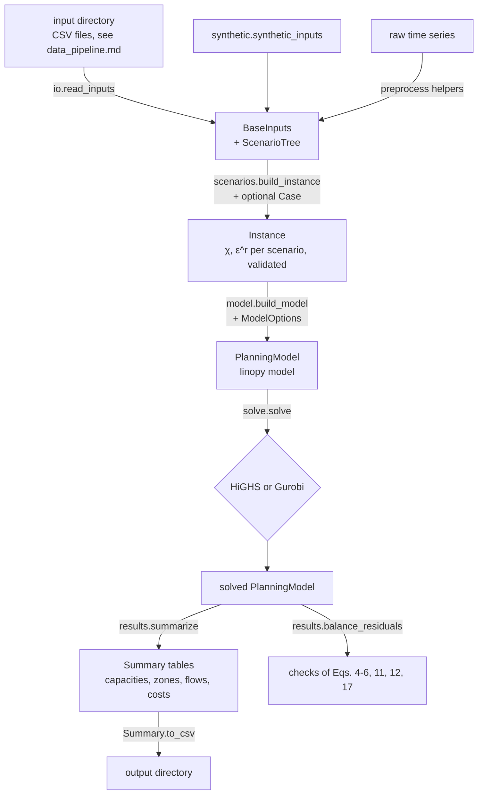

# Software architecture

## Data flow

## Modules (`src/txh2_framework/`)

| Module | Content |
|---|---|
| `parameters.py` | `Parameters`: the techno-economic parameters, with validation, the annuity factor of Eq. (2), overrides, capex scaling, and the flat record layout of `parameters.csv` |
| `inputs.py` | `BaseInputs` (scenario-independent profiles of a region), `Instance` (one model instance with scenario arrays), `Pipeline`; shape, sign and consistency checks |
| `scenarios.py` | `Level`, `ScenarioTree` (two independent factors), `Case` (sensitivity overrides), `build_instance` |
| `io.py` | read and write the input directory format |
| `model.py` | `ModelOptions`, `build_model`: variables, objective and constraints of [formulation.md](formulation.md), named by equation number |
| `solve.py` | `solve`: in-memory hand-over to HiGHS (default) or Gurobi; raises `SolveError` unless the solution is optimal |
| `results.py` | `solution_arrays`, `balance_residuals` (recomputes the balance equations from the solution), `summarize` and `Summary` |
| `preprocess.py` | steps of the data pipeline: hourly output per resource, gap filling, sums by zone, capacity factors, planned output, flat hourly rates, assembly of `BaseInputs` from frames |
| `synthetic.py` | the synthetic example region, illustrative parameters, the article's scenario tree |
| `cli.py` | the `txh2-framework` command: `synthetic` and `run` |

Arrays are ordered zone, hour, scenario (`[i, t, s]`).

- The linopy model uses the dimensions `i` (zone), `k` (technology), `t` (hour), `s` (scenario) and `a` (pipeline arc).
- `h_tr` is defined only on the arcs: both directions of every corridor listed in the inputs, labelled `from->to`.
- Two incidence matrices map each arc to the zone it leaves and the zone it enters. They give the outflow and inflow terms of Eq. (5).

## Solvers

- **HiGHS** (default, open source, installed with `highspy`):
  - interior point followed by crossover, so the solution is a vertex;
  - suitable for the examples and for reduced instances (fewer zones, hours or scenarios).
- **Gurobi** (optional):
  - `pip install gurobipy` plus a licence, then `solve(pm, solver="gurobi")`;
  - the defaults are barrier and crossover, which is the usual choice for large planning LPs.
- Solver options go in a mapping and override the defaults, for example `solve(pm, options={"time_limit": 3600})` for HiGHS or `solve(pm, solver="gurobi", options={"Threads": 8})`.

## Problem size

For $\lvert I\rvert$ zones, $\lvert T\rvert$ hours, $\lvert S\rvert$ scenarios and $\lvert A\rvert$ directed pipeline arcs, the model has about

- $9\,\lvert I\rvert\,\lvert T\rvert\,\lvert S\rvert$ hourly variables: $\epsilon^{h}$, $\epsilon^{dis}$, $\epsilon^{n}$, $\epsilon^{cha}$, $\epsilon^{e2h}$, $h^{se}$, $h^{smr}$, $w$, $o$;
- $2\,\lvert I\rvert(\lvert T\rvert+1)\lvert S\rvert$ storage levels, $\theta^{b}$ and $\theta^{h}$;
- $\lvert A\rvert\,\lvert T\rvert\,\lvert S\rvert$ pipeline flows;
- $4\,\lvert I\rvert$ first-stage variables, $x$ and $\psi$;
- somewhat fewer constraints than variables.

The load-flexibility variant and the curtailment extension each add $\lvert I\rvert\,\lvert T\rvert\,\lvert S\rvert$ variables.

| Instance | Variables (approx.) |
|---|---|
| synthetic example: 4 zones, 72 h, 9 scenarios | 34 thousand (26 thousand constraints) |
| 8 zones, 8,760 h, 9 scenarios, 16 arcs | about 8 million (about 6 million constraints) |

linopy builds the model from arrays. On a laptop, the full-year, eight-zone instance above builds in about a second and uses under 2 GB of memory.

Solving it is another matter. It needs a commercial barrier solver, or a shorter contiguous block of hours with `Instance.hour_weight` set to keep the costs annual. Non-contiguous representative periods are not implemented (see [formulation.md](formulation.md), conventions).

## Output tables

`results.summarize(pm)` returns a `Summary`, and `Summary.to_csv(dir)` writes four files. "Expected annual" means probability-weighted over scenarios and scaled by `hour_weight`.

| File | Rows | Columns (unit) |
|---|---|---|
| `capacities.csv` | zone | `electrolyzer` (MW), `tank` (t), `fuel_cell` (MW) |
| `zones.csv` | zone | `h2_demand_t`, `green_h2_sold_t`, `smr_h2_t` (t/yr); `satisfaction_rate` (–, empty where a zone has no hydrogen demand); `electrolysis_mwh`, `fuel_cell_mwh`, `ccgt_mwh` (MWh/yr); `ccgt_peak_mw` (MW, maximum over hours and scenarios); `ccgt_co2_t`, `smr_co2_t` (t CO2/yr); `battery_charge_mwh`, `battery_discharge_mwh`, `curtailment_mwh` (MWh/yr); `h2_export_t`, `h2_import_t` (t/yr) |
| `flows.csv` | directed arc | `from`, `to`, `distance_km` (km), `expected_flow_t` (t/yr) |
| `costs.csv` | cost component | `k$_per_year`: annualised installation, fixed O&M, pipeline transport, water, SMR hydrogen and carbon, CCGT electricity and CCS, hydrogen and oxygen revenue (negative), and `total` (equals the objective) |

The command line also writes `balance_residuals.json`: the largest residual of Eqs. (4)–(6), (11), (12) and (17), recomputed from the solution.

## Tests

`pytest` (directory `tests/`) checks:

- the data interface: validation errors (including non-finite values, wrong units and duplicate parameters) and the input format round trip;
- the preprocessing helpers and the end-to-end preparation example;
- the scenario construction and the sensitivity overrides;
- an optimal solve of the synthetic case;
- every balance equation, recomputed from the solution;
- the bounds of Eqs. (7), (8), (13), (14) and (17);
- that pipeline flows appear only on corridors;
- that the cost components sum to the objective;
- the load-flexibility variant, the capacity bound, the curtailment extension, option validation, solver options, a case without pipelines, the command line and the minimal example.
