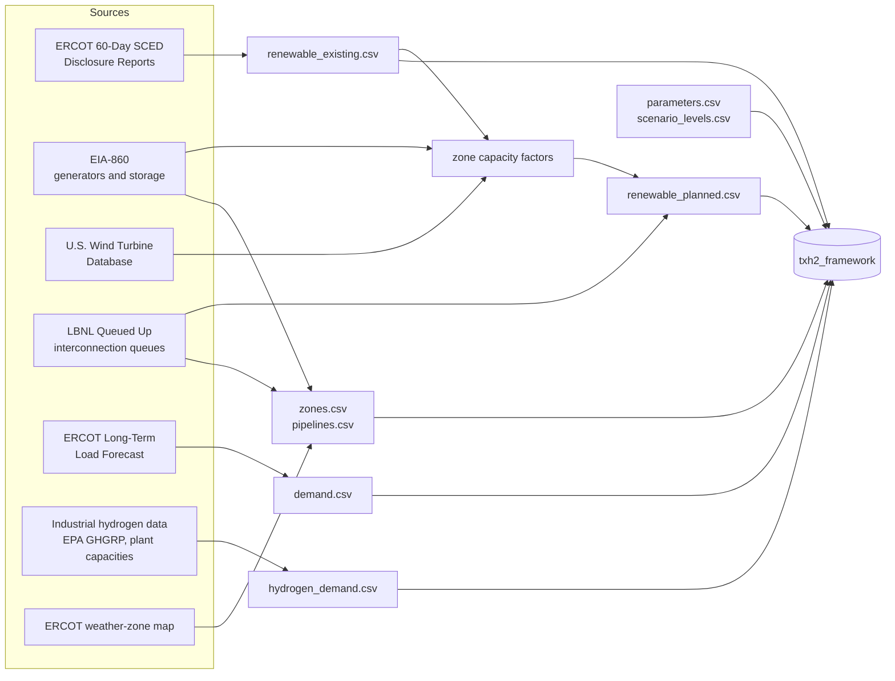

# Data pipeline and input schemas

This document has two parts:

- how each model input is built from public sources, following the data description in Section 2 of the article;
- the file format the framework reads.

It describes structure only. **This repository contains no ERCOT data and none of the processed inputs used for the article.** The only data shipped are synthetic, made by `txh2_framework.synthetic`.

The module `txh2_framework.preprocess` implements the generic steps (hourly output per resource, gap filling, sums by zone, capacity factors, planned output, flat hourly rates, assembly). [`examples/prepare_inputs.py`](../examples/prepare_inputs.py) runs them end to end on synthetic interval records and writes an input directory.

## Overview

## Steps

### 1. Spatial units

- The article divides ERCOT into its eight weather zones: Coast, East, Far West, North, North Central, South, South Central and West. Each zone shares one set of meteorological data, so all wind or solar resources in a zone have the same hourly capacity factor.
- Build a county-to-zone table from ERCOT's weather-zone map. Every source below is located by county and aggregated to zones through this table.

### 2. Output of existing wind and solar (`renewable_existing.csv`)

- **Source:** ERCOT 60-Day SCED Disclosure Reports (report NP3-965-ER), generation-resource files for the base year (2022 in the article). They are published as daily archives 60 days after the operating day.
- **Steps:**
  1. Keep the wind and solar resources (resource types `WGR` and `PVGR`) and their dispatch base point (MW) at every SCED interval.
  2. Map each resource to its county, for example by matching it to its plant in EIA-860, which lists the county. Then map the county to its zone.
  3. Average each resource's intervals within each hour, which gives its energy in MWh for that hour (`hourly_resource_output`).
  4. Fill short gaps per resource (`fill_short_gaps`), then sum by zone (`sum_by_zone`). Gaps are handled per resource; after summing, a silent resource would be hidden by the others in its zone.

### 3. Zone capacity factors

- **Sources:** EIA-860, generator files for wind and solar (operating units: nameplate MW and county), with the U.S. Wind Turbine Database as a cross-check of wind locations and capacity.
- **Step:** divide the hourly zone output of step 2 by the installed capacity of the zone (`capacity_factors`), separately for wind and solar if both are tracked. The article applies the same capacity factors to installed and planned resources in a zone.

### 4. Output of planned additions (`renewable_planned.csv`)

- **Source:** LBNL "Queued Up" interconnection-queue data, ERCOT entries.
- **Steps:**
  1. Select wind and solar projects that are still active and have a proposed online date by the target year (2030 in the article).
  2. Aggregate their capacity by county and then by zone.
  3. Multiply the planned capacity by the zone capacity factors of step 3 (`planned_output`). The result is the output of all planned capacity, i.e. at a 100 % completion rate. The scenario completion rate is applied in the model (see [scenarios.md](scenarios.md)).

### 5. Battery capacity (`zones.csv`)

- **Sources:**
  - existing storage: EIA-860 energy-storage file (nameplate energy capacity, county);
  - planned storage: storage projects in the interconnection queue by the target year.
- **Step:** aggregate both by zone into `battery_existing_mwh` and `battery_planned_mwh`.
- $\beta_i$ is an **energy** capacity (MWh). If a source gives only power (MW), convert it with an explicit storage duration and record that assumption.

### 6. Electricity demand (`demand.csv`)

- **Source:** ERCOT Long-Term Load Forecast, hourly forecasts by weather zone.
- **Step:** take the target year and write one column per zone (MWh per hour). This is the medium (reference) level; the low and high levels are factors on it (`scenario_levels.csv`).
- Columns are matched to zones by name when the file is read.

### 7. Hydrogen demand (`hydrogen_demand.csv`)

- **Sources:**
  - facility locations from the EPA Greenhouse Gas Reporting Program (hydrogen producers, refineries, ammonia and chemical plants);
  - merchant hydrogen plant capacities (Hydrogen Tools / HyARC);
  - published Texas hydrogen-demand studies (see the article's references).
- **Steps:**
  1. Compile annual industrial hydrogen demand by facility.
  2. Aggregate it by county and then by zone.
  3. Express it as an hourly rate. The default is a flat profile, i.e. annual demand divided by 8,760 (`flat_hourly`); use real hourly profiles where they exist.
- The article keeps hydrogen demand fixed across scenarios.

### 8. Pipeline corridors (`pipelines.csv`)

- One row per pair of **adjacent** zones (zones that share a border), with the straight-line distance between the zone centres in km. For example, a zone centre can be the centroid of its counties.
- Flows are allowed in both directions; the transport cost is $c^{tr}$ per tonne and km.

### 9. Parameters and scenario design

- **`parameters.csv`:** the techno-economic parameters of [formulation.md](formulation.md) (names, values, units). The article's benchmark values are in its Table 3.
- **`scenario_levels.csv`:** the levels of the two uncertain factors (article Table 1).

## Data preparation rules and QA checks

These rules keep the hourly series aligned. Equal-length arrays alone do not guarantee that hour $t$ means the same hour in every file.

- **One clock:**
  - Convert every timestamp to one clock before aggregating, e.g. UTC or year-round Central Standard Time, with hour-beginning labels. ERCOT data are stamped in Central Prevailing Time, which observes daylight saving.
  - The spring-forward hour does not exist locally and the fall-back hour occurs twice. Both problems disappear once the series are converted to a fixed offset.
  - Build one complete hourly axis (`preprocess.hourly_axis`) and reindex every series to it.
- **Year length:**
  - A non-leap year has 8,760 hours.
  - For a leap year, either drop 29 February in every series or keep 8,784 hours. The model only needs all files to use the same axis; `hour_weight` = 8760 / $\lvert T\rvert$ keeps costs annual.
- **Missing data:**
  - An hour in which a resource has no interval record is missing (NaN), not zero.
  - Interpolate runs of up to a few hours (`fill_short_gaps`, `max_gap=3` by default). Fix longer runs at the source, or fill them by an explicit, recorded rule, such as the same hour on neighbouring days.
  - Hours before a resource entered service, or after it retired, are zero. Set them explicitly before filling, otherwise they count as gaps.
- **Partial hours:** the hourly value is the mean of the intervals present in that hour. Record intervals with suspicious values (negative output, output above the resource's capability) and decide on them before averaging.
- **Resource matching:**
  - Keep the resource → county → zone table under version control.
  - `sum_by_zone` returns the resources without a zone. Review them and their capacity; the matched capacity should cover nearly all installed wind and solar capacity.
- **Capacity denominator:**
  - Divide by the capacity in service in each hour, using commissioning dates (EIA-860 operating month and year) where available. Year-end capacity understates capacity factors early in the year.
  - `capacity_factors` clips values to [0, 1]. Look at the unclipped maximum first: values above 1 point to a matching or capacity error.
- **QA checks before writing the inputs:**
  - annual energy by zone and technology against published totals (ERCOT fuel-mix reports, EIA-923);
  - capacity-factor statistics per zone and month;
  - annual demand per zone against the load forecast;
  - annual hydrogen demand per zone against its sources;
  - `read_inputs` on the written directory, which applies the format checks below.

## Input directory format

`txh2_framework.io.read_inputs(directory)` reads, and `write_inputs` writes, the following files. Every file is checked when read; a violation raises an error that names the file.

| File | Columns | Unit | Rules |
|---|---|---|---|
| `zones.csv` | `zone`, `battery_existing_mwh`, `battery_planned_mwh` | MWh | unique zone names; values ≥ 0 |
| `pipelines.csv` | `zone_a`, `zone_b`, `distance_km` | km | known zones; no self-loops; each pair at most once (either order); distance > 0 |
| `demand.csv` | `hour`, one column per zone | MWh | `hour` = 1..T without gaps; zone columns match `zones.csv` by name; values finite and ≥ 0 |
| `renewable_existing.csv` | `hour`, one column per zone | MWh | as above, same T |
| `renewable_planned.csv` | `hour`, one column per zone | MWh at 100 % completion | as above, same T |
| `hydrogen_demand.csv` | `hour`, one column per zone | t | as above, same T |
| `scenario_levels.csv` | `factor` (`demand` or `completion`), `level`, `value`, `probability` | factor / rate | probabilities of each factor sum to 1 |
| `parameters.csv` | `name`, `value`, `unit` | see [formulation.md](formulation.md) | every parameter once; `c_ins.<technology>` and `c_om.<technology>` for `electrolyzer`, `tank`, `fuel_cell`; values finite and ≥ 0; `unit` must equal the unit in `parameters.canonical_units()` (no conversion is done) |
| `README.txt` (optional) | free text | – | kept as the dataset description |

To see a complete example, run `txh2-framework synthetic my_inputs/`. It writes a synthetic directory in this format.

## Terms of use of the sources

Check each publisher's current terms before you redistribute anything derived from these data.

| Source | Where | Terms (summary) |
|---|---|---|
| ERCOT 60-Day SCED Disclosure Reports; Long-Term Load Forecast | [ercot.com](https://www.ercot.com) | ERCOT Terms of Use |
| EIA-860 | [eia.gov/electricity/data/eia860](https://www.eia.gov/electricity/data/eia860/) | U.S. government data; cite EIA |
| LBNL Queued Up | [emp.lbl.gov/queues](https://emp.lbl.gov/queues) | see the data release; cite Rand et al. |
| U.S. Wind Turbine Database | [doi:10.5066/F7TX3DN0](https://doi.org/10.5066/F7TX3DN0) | public domain (USGS data release) |
| EPA GHGRP | [epa.gov/ghgreporting](https://www.epa.gov/ghgreporting) | U.S. government data; cite EPA |
| Hydrogen Tools (HyARC) merchant plant capacities | [h2tools.org](https://h2tools.org) | see the site |
